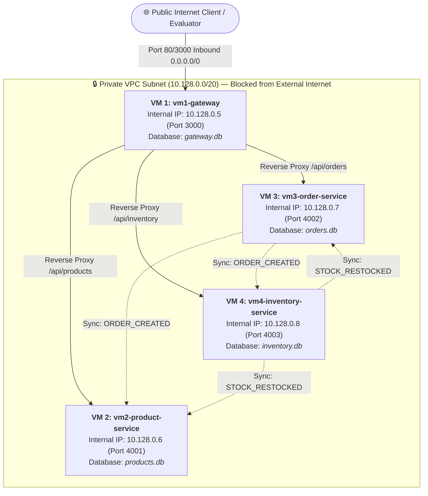

# QuantumStore • Distributed Cloud E-Commerce Microservices

A distributed e-commerce system built for 4 microservices hosted across 4 separate Google Cloud (GCP) Virtual Machines:
- **VM 1 (`vm1-gateway`)**: Public API Gateway & Frontend UI (`10.128.0.5`)
- **VM 2 (`vm2-product-service`)**: Product Catalog Service & `products.db` (`10.128.0.6`)
- **VM 3 (`vm3-order-service`)**: Order Processing Service & `orders.db` (`10.128.0.7`)
- **VM 4 (`vm4-inventory-service`)**: Warehouse Inventory Service & `inventory.db` (`10.128.0.8`)

---

## 1. Cloud Network Architecture



### Microservice & VM Specifications

| Virtual Machine | Microservice Role | Internal IP | Inbound Firewall Rules | Mini-Database |
| :--- | :--- | :--- | :--- | :--- |
| **`vm1-gateway`** | **API Gateway & Storefront UI** | **`10.128.0.5`** | `ALLOW 80/tcp, 3000/tcp from 0.0.0.0/0` | `gateway.db` |
| **`vm2-product-service`** | **Product Catalog** | **`10.128.0.6`** | `ALLOW 4001/tcp from 10.128.0.0/20 only` | `products.db` |
| **`vm3-order-service`** | **Order Processing** | **`10.128.0.7`** | `ALLOW 4002/tcp from 10.128.0.0/20 only` | `orders.db` |
| **`vm4-inventory-service`** | **Warehouse Inventory** | **`10.128.0.8`** | `ALLOW 4003/tcp from 10.128.0.0/20 only` | `inventory.db` |

---

## 2. Distributed Database Synchronization Protocol

1. **Order Creation Synchronization Flow**:
   - Customer submits checkout through **`vm1-gateway` (Port 3000)**.
   - Gateway routes request to **`vm3-order-service` (`10.128.0.7:4002`)**.
   - VM-3 inserts order into `orders.db`, creates unique sync event UUID (`evt_order_...`), and dispatches:
     - `POST http://10.128.0.8:4003/sync/receive` ➔ **`inventory.db` on VM-4**: Allocates warehouse stock.
     - `POST http://10.128.0.6:4001/sync/receive` ➔ **`products.db` on VM-2**: Decrements catalog available stock.
   - All 3 databases reach consistent state in real time.

2. **Warehouse Restock Synchronization Flow**:
   - Restock triggered on **`vm4-inventory-service` (`10.128.0.8:4003`)**.
   - VM-4 writes to `inventory.db` and dispatches `STOCK_RESTOCKED`:
     - `POST http://10.128.0.6:4001/sync/receive` ➔ **`products.db` on VM-2**: Increases live product stock available on the storefront.
     - `POST http://10.128.0.7:4002/sync/receive` ➔ **`orders.db` on VM-3**: Logs sync audit trail.

---

## 3. How to Run

### Option 1: Run Locally (Multi-Process)
```bash
npm install
npm start
```
Access at `http://localhost:3000`.

### Option 2: Docker Compose (Using your GCP Internal Subnet)
```bash
docker compose up --build
```
Only Port 3000 is mapped to host; microservices run on internal IPs `10.128.0.5`, `10.128.0.6`, `10.128.0.7`, and `10.128.0.8`.

### Option 3: Run on your GCP VMs

1. **On `vm1-gateway` (`10.128.0.5`)**:
   ```bash
   NODE_ENV=production PORT=3000 \
   PRODUCT_SERVICE_URL=http://10.128.0.6:4001 \
   ORDER_SERVICE_URL=http://10.128.0.7:4002 \
   INVENTORY_SERVICE_URL=http://10.128.0.8:4003 \
   node gateway/src/server.js
   ```

2. **On `vm2-product-service` (`10.128.0.6`)**:
   ```bash
   NODE_ENV=production PORT=4001 \
   ORDER_SERVICE_URL=http://10.128.0.7:4002 \
   INVENTORY_SERVICE_URL=http://10.128.0.8:4003 \
   node product-service/src/server.js
   ```

3. **On `vm3-order-service` (`10.128.0.7`)**:
   ```bash
   NODE_ENV=production PORT=4002 \
   PRODUCT_SERVICE_URL=http://10.128.0.6:4001 \
   INVENTORY_SERVICE_URL=http://10.128.0.8:4003 \
   node order-service/src/server.js
   ```

4. **On `vm4-inventory-service` (`10.128.0.8`)**:
   ```bash
   NODE_ENV=production PORT=4003 \
   PRODUCT_SERVICE_URL=http://10.128.0.6:4001 \
   ORDER_SERVICE_URL=http://10.128.0.7:4002 \
   node inventory-service/src/server.js
   ```
